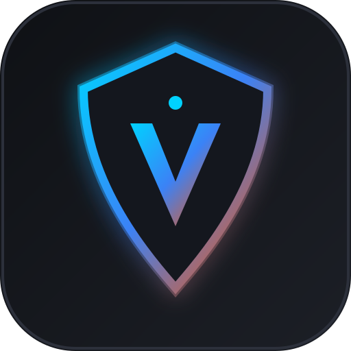

# Valorex (متصفح فالوركس)

<p align="center">
  
</p>

<p align="center">
  <b>Valorex</b> — Ultra-fast, lightweight, memory-safe, privacy-respecting native desktop web browser engineered in <b>Rust</b>.<br>
  متصفح ويب مكتبي أصيل فائق السرعة وخفيف الوزن مبني بلغة <b>رست (Rust)</b> مع حماية خصوصية متقدمة ودعم عربي كامل.
</p>

<p align="center">
  <a href="https://seotarek.github.io/valorex/"></a>
  <a href="https://github.com/seotarek/valorex/releases"></a>
  <a href="https://github.com/seotarek/valorex/actions/workflows/rust.yml"></a>
  
  
  
  
  <a href="https://slsa.dev"></a>
  
</p>

<p align="center">
  <a href="https://seotarek.github.io/valorex/"><b>🌐 Visit Live GitHub Pages Website (الموقع الرسمي)</b></a> &bull;
  <a href="https://github.com/seotarek/valorex/releases"><b>📦 Download Releases (التحميلات)</b></a>
</p>

---

## ⚡ Overview (نظرة عامة)

**Valorex** is designed as a streamlined, lightning-fast alternative to bloated Electron apps and heavy Chromium forks. Powered by Rust's zero-cost abstractions, native WebKitGTK rendering, and the official Brave `adblock-rust` rule-matching engine, Valorex starts in milliseconds, uses **10x less RAM** than Electron, and blocks aggressive trackers before they hit your CPU.

**فالوركس** متصفح ويب مكتبي متطور تم تصميمه من الصفر ليكون بديلاً خفيفاً وفائق السرعة للمتصفحات الثقيلة وتطبيقات Electron المستنزفة للذاكرة. يعتمد على لغة Rust ومحرك WebKitGTK الأصيل مع تكامل مباشر مع محرك حجب الإعلانات الرسمي لمتصفح Brave (`adblock-rust`)، مما يوفر تصفحاً آمناً وفورياً باستهلاك رام لا يتعدى 25–40 ميجابايت في وضع الخمول.

---

## 🚀 Key Features (أبرز المميزات)

- **Zero-Bloat Performance (أداء فائق واستجرار منعدم للذاكرة):** Compiled native standalone binary (~8MB) with minimal idle RAM (25–40MB vs 400MB+ for Chromium/Electron).
- **Valorex Shield (درع فالوركس لحجب الإعلانات والتتبع):** Official Brave `adblock-rust` engine supporting EasyList, EasyPrivacy, cosmetic element hiding, and real-time blocked telemetry counter.
- **Chrome CSD & Tab Strip (شريط نافذة وألسنة متطورة):** Pixel-perfect client-side decorations (CSD), full window dragging, tab pinning, tab duplication, tab reordering, and instant closed tab restoration (`Ctrl+Shift+T`).
- **SQLite Storage Engine (محرك تخزين محلي SQLite WAL):** Embedded SQLite with Write-Ahead Logging for lightning-fast history, bookmarks, and download tracking.
- **1-Click Browser Data Migration (استيراد البيانات بنقرة واحدة):** Seamless profile import from Google Chrome, Brave, Mozilla Firefox, Microsoft Edge, and Chromium.
- **Pure BiDi RTL/LTR Symmetry (تناظر ثنائي الاتجاه ودعم عربي أصيل):** Built from day one with CSS logical properties, direction isolation on URLs and paths, and zero awkward misalignments.
- **Built-in Internal Pages (صفحات النظام المدمجة):** Custom `valorex://` protocol pages:
  - `valorex://newtab` — Clean dashboard with clock, curated shortcuts, and live Shield telemetry.
  - `valorex://history` — Full browsing history search and management with single-click clear.
  - `valorex://bookmarks` — Hierarchical bookmarks library with instant search.
  - `valorex://downloads` — Real-time download manager with file path isolation.
  - `valorex://settings` — Visual customization (CSD toggle, tab close buttons, language switch, adblock dials).
- **Gemini Quick Access (الوصول السريع إلى Gemini):** Omnibox search routing and floating text-selection action bubble for instant Google search, copy, and Gemini query launch.

---

## 📊 Technical Benchmark (المقارنة التقنية)

| Metric (المعيار) | Valorex (فالوركس) | Chromium Forks | Electron Apps |
| :--- | :--- | :--- | :--- |
| **Idle Memory (الذاكرة في الخمول)** | **25 – 40 MB** | 350 – 600 MB | 450 – 800 MB |
| **Binary Size (حجم الملف الموزع)** | **~8 MB** | ~180 MB | ~140 MB |
| **Cold Startup (زمن الإقلاع البارد)** | **< 120 ms** | ~850 ms | ~1,800 ms |
| **Memory Safety (أمان الذاكرة)** | **100% Rust Ownership** | C++ (UAF risks) | Node.js + V8 |
| **Adblock Engine (محرك الحجب)** | **Brave adblock-rust** | Extension required | Extension required |
| **BiDi Arabic / English (الدعم العربي)** | **Native BiDi Isolated** | Generic | Generic |

> **ملاحظة منهجية القياس (Benchmark Methodology Note):** تم قياس الأرقام محلياً في بيئة اختبار لينكس (Fedora/GNOME x86_64، ذاكرة خمول بصفحة واحدة فارغة عبر قياس Resident Set Size، وحجم الملف التنفيذي المجرد Stripped). قد تختلف النتائج العملية باختلاف عتاد الجهاز والتوزيعة وإصدار مكتبة WebKitGTK المثبتة.

---

## 📁 Architecture (معمارية المشروع)

```
valorex/
├── Cargo.toml            # Project manifest & release optimization profiles
├── assets/               # Brand assets, vector logos & desktop entry
│   ├── valorex.svg       # Official vector icon
│   └── valorex.desktop   # XDG standard desktop integration
├── docs/                 # Official GitHub Pages documentation & landing page
│   ├── index.html        # Interactive bilingual showcase
│   └── assets/           # Web assets & branding
├── src/
│   ├── main.rs           # Application entrypoint & GTK event loop lifecycle
│   ├── lib.rs            # Library exports & integration bindings
│   ├── browser/          # Dual-layer window & content webview controller
│   │   ├── mod.rs        # IPC dispatcher, security origin guards & navigation
│   │   └── tab.rs        # TabManager, pinning, reordering & closed tab cache
│   ├── config/           # User configuration & persistent JSON storage
│   ├── i18n.rs           # Bilingual localization engine & CLDR helpers
│   ├── importer/         # Browser profile migration (Chrome, Brave, Firefox, Edge)
│   ├── protocol/         # Internal pages renderer (valorex:// protocol)
│   ├── shield/           # Valorex Shield engine & background filter updater
│   │   ├── mod.rs        # Rule matching, cosmetic script injection & counters
│   │   └── updater.rs    # Automated EasyList/EasyPrivacy background updater
│   ├── storage/          # SQLite WAL storage engine (History, Bookmarks, Downloads)
│   └── ui/               # Modern Chrome-like CSD titlebar, Omnibox & Tab bar
└── tests/                # Automated unit & integration test suites (34 tests)
```

---

## 🛠️ Building & Installation (التثبيت والبناء)

### 1. Prerequisites (المتطلبات الأساسية)

#### Fedora / RHEL / CentOS:
```bash
sudo dnf install -y rust cargo gtk3-devel webkit2gtk4.1-devel
```

#### Ubuntu / Debian / Linux Mint:
```bash
sudo apt update && sudo apt install -y build-essential curl pkg-config libgtk-3-dev libwebkit2gtk-4.1-dev
```

#### Arch Linux / Manjaro:
```bash
sudo pacman -S --needed base-devel rust webkit2gtk-4.1
```

---

### 2. Building from Source (التجميع من المصدر)

```bash
# 1. Clone the repository
git clone https://github.com/seotarek/valorex.git
cd valorex

# 2. Run automated test suite (34 unit tests)
cargo test

# 3. Build optimized release binary
cargo build --release

# 4. Launch Valorex
./target/release/valorex
```

---

### 3. System Desktop Integration (التثبيت في قائمة التطبيقات)

To install Valorex into your Linux desktop application menu:
```bash
sudo cp target/release/valorex /usr/local/bin/
sudo cp assets/valorex.svg /usr/share/icons/hicolor/scalable/apps/valorex.svg
sudo cp assets/valorex.desktop /usr/share/applications/
sudo update-desktop-database
```

---

## ⌨️ Keyboard Shortcuts (اختصارات لوحة المفاتيح)

| Shortcut (الاختصار) | Action (الإجراء) | الوصف بالعربية |
| :--- | :--- | :--- |
| `Ctrl + T` | New Tab | فتح علامة تبويب جديدة |
| `Ctrl + W` | Close Tab | إغلاق علامة التبويب الحالية |
| `Ctrl + Shift + T` | Reopen Closed Tab | استرجاع آخر علامة تبويب مغلقة |
| `Ctrl + Tab` | Next Tab | الانتقال إلى التبويب التالي |
| `Ctrl + Shift + Tab` | Previous Tab | الانتقال إلى التبويب السابق |
| `Ctrl + 1` .. `Ctrl + 9` | Switch to Tab N | الانتقال مباشرة إلى رقم التبويب |
| `Ctrl + R` / `F5` | Reload Page | إعادة تحميل الصفحة |
| `Ctrl + L` / `Alt + D` | Focus Omnibox | التركيز على شريط العنوان والبحث |
| `Ctrl + D` | Bookmark Tab | إضافة الصفحة الحالية إلى المفضلة |
| `Ctrl + H` | History | فتح سجل التصفح (`valorex://history`) |
| `Ctrl + J` | Downloads | فتح إدارة التنزيلات (`valorex://downloads`) |
| `Ctrl + B` | Bookmarks | فتح المفضلة (`valorex://bookmarks`) |
| `Ctrl + +` / `Ctrl + -` | Zoom In / Out | تكبير / تصغير الصفحة |
| `Ctrl + 0` | Reset Zoom | إعادة تعيين حجم الصفحة الافتراضي |
| `F11` | Toggle Fullscreen | ملء الشاشة / الخروج من ملء الشاشة |

---

## 📄 License (الترخيص)

This project is licensed under the [GNU General Public License v3.0 or later](LICENSE).

---

## 👨‍💻 Author & Maintainer

**Tarek ([@seotarek](https://github.com/seotarek))**  
Crafted with passion in Rust for a faster, cleaner, and privacy-respecting web.
